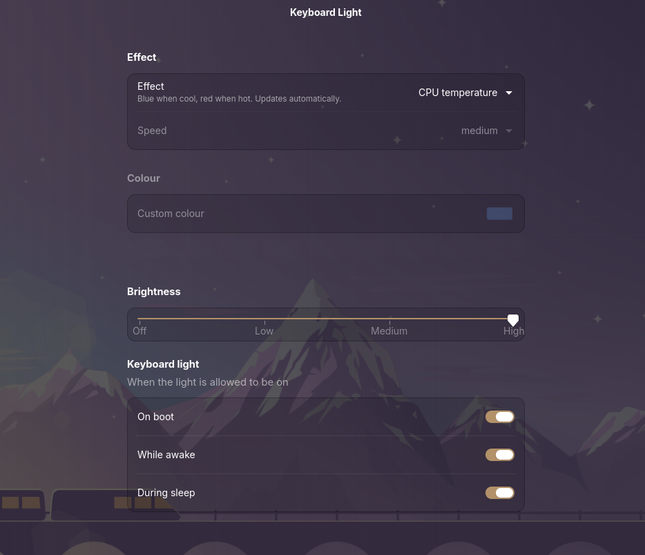
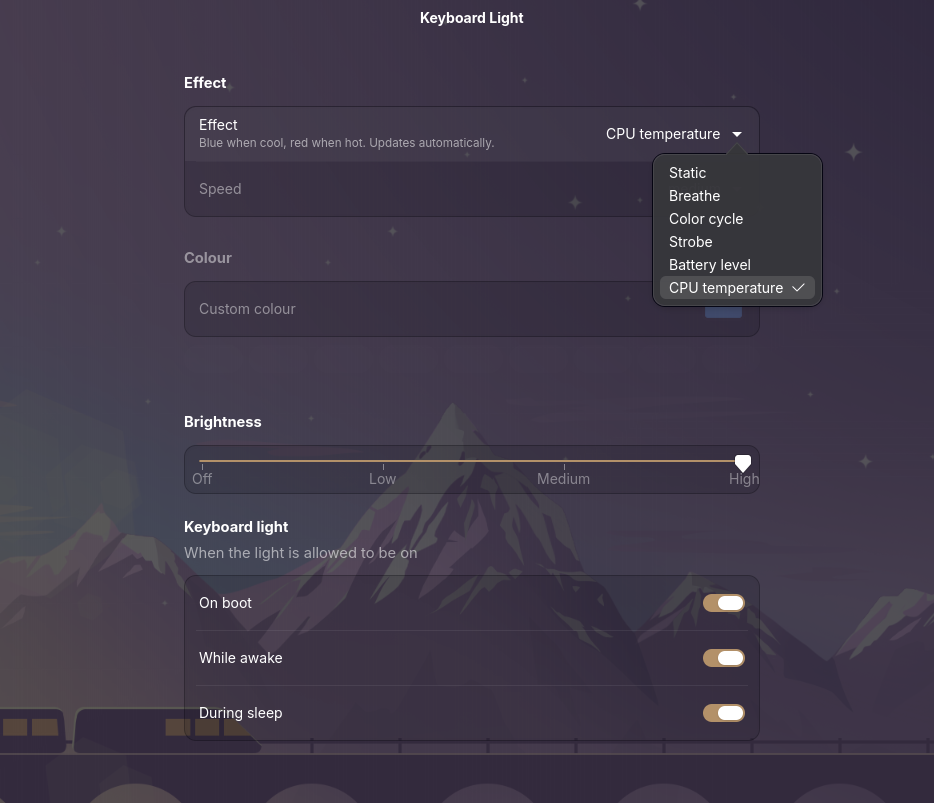

# kbd-color

Tiny keyboard light controller for ASUS laptops (tested target: TUF Gaming F17 FX706HF).
Uses the kernel's `asus-wmi` sysfs interface at `/sys/class/leds/asus::kbd_backlight/`. No dependencies beyond Python 3 (and GTK 4 + libadwaita, already on Ubuntu GNOME, for the settings app).

## Demo

The settings app (`kbd-color gui`), running on a TUF F17:

## Compatibility

Tested on one machine: ASUS TUF Gaming F17 FX706HF, Ubuntu GNOME, Intel CPU. Everything else is untested.

| Needs | Why |
| --- | --- |
| ASUS laptop with an RGB keyboard | uses `kbd_rgb_mode` / `kbd_rgb_state` from `asus-wmi` |
| Linux kernel 6.1+ | `asus::kbd_backlight` sysfs interface |
| Ubuntu / Debian (`plugdev` group) | the udev rule grants access through `plugdev`; Fedora and Arch don't have it by default |
| Intel CPU, for heat mode | the temperature sensor is read from `coretemp` / `x86_pkg_temp`; AMD (`k10temp`) isn't supported yet |
| GTK 4 + libadwaita, for the settings app | already on Ubuntu GNOME |

Known gaps:

- Heat mode stays white on AMD CPUs.
- White-only ASUS keyboards (no `kbd_rgb_mode` / `kbd_rgb_state`) get a misleading "No permission" error.
- On non-ASUS laptops the background service keeps restarting every 5 seconds.

Reports and fixes from other hardware are welcome; open an issue with your model and `uname -r`.

## Install

    ./install.sh      # symlinks kbd-color into ~/.local/bin, starts a background service (applies your setting at login, keeps battery/heat colours live) + a "Keyboard Light" app menu entry, installs a udev rule (sudo)
    ./uninstall.sh

The udev rule makes the light files writable by the `plugdev` group, so no sudo is needed at runtime.

## Use

    kbd-color red              # solid colour by name
    kbd-color ff8800           # solid colour by hex
    kbd-color cycle            # effects: static breathe cycle strobe
    kbd-color battery          # colour follows battery level: red low -> green full
    kbd-color heat             # colour follows CPU temperature: blue cool -> red hot
    kbd-color breathe cyan slow
    kbd-color next | prev      # switch to the next / previous effect
    kbd-color brightness 2     # 0-3
    kbd-color off | on
    kbd-color power awake on   # light on boot / awake / sleep: on|off
    kbd-color gui              # settings app (libadwaita): effect, colour, speed, brightness
    kbd-color apply            # re-apply saved setting (run at login)

The last setting is saved to `~/.config/kbd-color.json`.

## Layout

    kbd-color                  the whole program
    udev/99-kbd-color.rules    permission rule
    install.sh / uninstall.sh

## Notes

Effect numbers and the speed/colour encoding match G-Helper's TUF path (asus-wmi `kbd_rgb_mode`).
Not every keyboard draws every effect; try them in the settings app and ignore the ones yours doesn't support.
Changes are sent as temporary sets, so the laptop's memory isn't rewritten on every slider move.

### Battery and heat colours

These are software-driven: `kbd-color daemon` (run by the `kbd-color.service` systemd user service) reads the
battery level every 30 seconds or the CPU package temperature every 2 seconds and sets a matching static colour.
It only rewrites the light when the colour moves by a noticeable step, and never touches brightness.
With any other effect the service sleeps until the settings file changes or an Fn hotkey is pressed, so it
uses no CPU while idle.
Battery: red at 10% and below, green at 80% and above. Heat: blue at 40C and below, red at 90C and above.
Logs: `journalctl --user -u kbd-color`.

### Hotkeys

Fn+Up / Fn+Down change brightness (handled by the kernel). Fn+Left switches to the next effect, and a small popup
shows its name. The background service does this by reading the "Asus WMI hotkeys" input device; the udev rule lets
the `plugdev` group read that one device only, not the main keyboard. Fn+Right sends nothing to Linux on the
FX706HF, so Fn+Left wraps around through all effects. Run `kbd-color keys` to see the codes other Fn keys send;
map them in `HOTKEYS` at the top of `kbd-color`.
